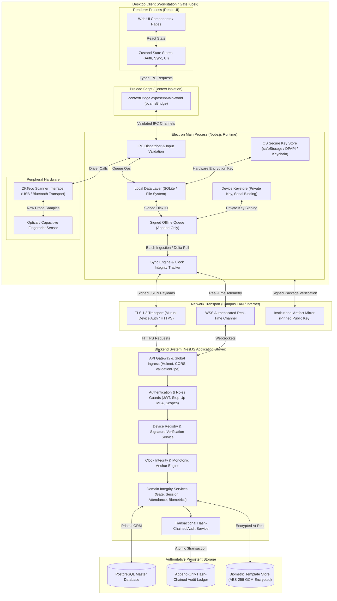

# BCAMS Threat Model

**Document Reference:** `docs/programme/security/threat-model.md`  
**Programme Chunk:** C0.4 (Threat model and security requirements)  
**Authoritative Baselines:** Locked Decisions L1 to L16, Open Decisions O1 to O12, C0.1, C0.2, C0.3, PRD v1.3, SRS v1.1  
**Scope:** `bcams-desktop` at `./bcams-desktop` (Electron/React client) and `bcams-be` at `./bcams-be` (NestJS/PostgreSQL backend)

---

## 1. Executive Summary & Methodology

BCAMS is a mission-critical, hybrid-matching attendance system for tertiary institutions that enforces student class attendance eligibility and staff gate physical access accountability. The system operates in hostile, partially-connected operational environments, including campus lecture halls with zero connectivity and turnstile kiosks subject to physical tampering.

This threat model applies the **STRIDE** methodology (Spoofing, Tampering, Repudiation, Information Disclosure, Denial of Service, Elevation of Privilege) combined with an exhaustive **Abuse Case Analysis**.

Under **Locked Decision L5**, the server is authoritative for punctuality, clock integrity, geofence validation, and attendance qualification. The desktop client operates as an offline-capable, cryptographically-bound endpoint holding scoped cached data.

---

## 2. System Architecture & Data Flow Diagram

---

## 3. Asset Classification

| Asset ID | Asset Name | Description & Form | Sensitivity | Storage Location | Key Threat Concerns |
| :--- | :--- | :--- | :--- | :--- | :--- |
| **AST-01** | **Biometric Reference Templates** | Mathematical minutiae representations (ISO/IEC 19794-2). No raw image files stored. | **Critical** (Biometric PII) | Server: DB (AES-256-GCM). Client: Local SQLite (scoped, encrypted, 7-day lease). | Mass theft, identity spoofing, reverse-engineering minutiae. |
| **AST-02** | **Transient Biometric Probes** | Real-time scanner captures during matching attempts. | **Critical** (Ephemeral Biometric) | Memory only; discarded immediately after match evaluation. | Memory dumping, unauthorized persistent storage, sniffing. |
| **AST-03** | **Device Private Keys** | Ed25519 / RSA asymmetric private keys uniquely identifying registered terminals. | **Critical** (Device Identity) | Client OS Keystore (`safeStorage`). Never leaves client machine. | Extraction from stolen terminal, unauthorized signature forging. |
| **AST-04** | **User Authentication Tokens** | JWT Bearer access tokens and refresh tokens. | **High** (Session Credential) | Client memory (`safeStorage` encrypted cache for offline verifier). | Token theft, session hijacking, persistent storage in plaintext. |
| **AST-05** | **Event Signing Keys & HMAC Secrets** | Shared secrets or asymmetric keys used to sign attendance capture events. | **High** (Integrity Credential) | Client `safeStorage`, Backend database (credential hashes). | Forging attendance records, bypass of device binding. |
| **AST-06** | **Attendance & Gate Records** | `AttendanceEvent`, `ClockEvent`, `DailyClockRecord` capturing academic and staff presence. | **High** (Institutional Record) | Backend PostgreSQL, Client offline pending queue (`OfflineQueue`). | Tampering, retroactive deletion, late attendance spoofing. |
| **AST-07** | **Authoritative Audit Ledger** | Cryptographically hash-chained, append-only log of security and administrative operations. | **High** (Non-Repudiation) | Backend PostgreSQL (dedicated transactional schema). | Tampering with log sequence, truncation of security incidents. |
| **AST-08** | **Personal Identifiable Information (PII)** | Student matric, names, phone numbers, staff IDs, department appointments. | **Medium** (Privacy) | Backend database, Client local database (scoped roster). | Unauthorized bulk export, credential stuffing, scraping. |
| **AST-09** | **Software Update Packages** | Packaged Electron installer binaries and ASAR archives. | **Critical** (Supply Chain) | Update distribution server, Client staging directory. | Malicious update delivery, remote code execution (RCE). |

---

## 4. Threat Actor Profiles

| Actor ID | Actor Archetype | Capabilities & Access Level | Motivation | Target Assets |
| :--- | :--- | :--- | :--- | :--- |
| **ACT-01** | **Student Capturer** | Authorized operator of class session terminal. Holds valid credentials and `session_capture` capability. Has physical possession of workstation. | Record attendance for absent friends, boost attendance stats, bypass eligibility thresholds. | AST-06 (Attendance), AST-05 (Signatures). |
| **ACT-02** | **Student (Non-Capturer)** | End-user student attending classes. No administrative access. Physical access to finger sensor only. | Proxy attendance without attending lecture. | AST-01, AST-02 (Biometrics), AST-06. |
| **ACT-03** | **Lecturer** | Academic instructor. Authorizes class sessions. Scoped to assigned course offerings. | Avoid teaching obligations, close sessions prematurely, view unauthorized departmental data. | AST-06, AST-08 (PII). |
| **ACT-04** | **Head of Department (HOD)** | Department-level administrative manager. Scoped to single academic department. | Alter student exam clearance rosters, view institution-wide gate records, register unauthorized staff. | AST-06, AST-08, AST-07 (Audit). |
| **ACT-05** | **Super Administrator** | Full institutional administrative access across all departments, policies, and devices. | Malicious insider or compromised root account; arbitrary system tampering. | All Assets (AST-01 to AST-09). |
| **ACT-06** | **Gate Turnstile Staff** | Employee passing through gate or kiosk attendant monitoring turnstile. | Clock in while arriving late, clock out while leaving early, buddy punch for coworkers. | AST-06 (Gate Records). |
| **ACT-07** | **External Network Attacker** | Attacker on campus Wi-Fi, public internet, or compromised local network. No valid credentials. | Intercept traffic, MITM sync requests, alter time anchors, replay payloads, exploit web vulnerabilities. | AST-04 (Tokens), AST-05, AST-09. |
| **ACT-08** | **Physical Device Thief** | Has stolen an active desktop terminal or unattended kiosk laptop. Full physical access to disk and hardware ports. | Extract cached biometric templates, extract device private keys, submit fraudulent offline events. | AST-01 (Cached Templates), AST-03 (Device Keys). |
| **ACT-09** | **Malicious Insider / Rogue Tech** | IT staff or developer with local administrator access to workstations or database read access. | Inject fraudulent attendance events, disable audit logging, bypass license or verification gates. | AST-06, AST-07, AST-09. |

---

## 5. Comprehensive Abuse Case Analysis

### AC-01: Proxy Attendance via Fake Biometrics (Gummy Finger / Silicone Mold)
- **Description:** A student creates a gelatin, latex, or 3D-printed synthetic fingerprint mold of an absent peer and presses it against the ZKTeco scanner during class capture.
- **Threat Actor:** `ACT-02` (Student).
- **Target Assets:** `AST-02` (Transient Biometric Probe), `AST-06` (Attendance Record).
- **Attack Vector:** Physical presentation attack against the optical scanner surface.
- **Impact:** Fraudulent attendance credit awarded to absent student; undermines examination qualification integrity.
- **Mitigation Control:** Scanner hardware abstraction must enable hardware-level Live Finger Detection (LFD) / Fake Finger Detection (FFD) supported by the ZKTeco sensor; reject non-live biometric presentations.
- **Implementing Chunk:** `C2.6` (Scanner integration layer), `C0.5` (Scanner spike).
- **Strategy:** **Prevent**.

---

### AC-02: Staff Gate Buddy Punching at Unattended Turnstiles
- **Description:** A staff member scans their own finger and attempts to immediately scan a second finger or use a proxy device to clock in a colleague who has not yet arrived on campus.
- **Threat Actor:** `ACT-06` (Gate Staff).
- **Target Assets:** `AST-06` (Gate Records).
- **Attack Vector:** Multiple physical presentations in rapid succession at a turnstile kiosk.
- **Impact:** False presence recorded on campus; fraudulent payroll and punctuality records.
- **Mitigation Control:** 
  1. Biometric 1:N / 1:1 match binds strictly to the physical person presenting.
  2. Under **Locked Decision L11**, a staff member can only clock in once per day; subsequent scans evaluate sequence (2nd is clock-out, 3rd is totally discarded).
  3. Physical kiosk runs in fixed kiosk mode with zero user credential switching (**Locked Decision L4**).
- **Implementing Chunk:** `C1.5` (Domain integrity), `C2.5` (Device modes), `C2.7` (Local-first workflows).
- **Strategy:** **Prevent**.

---

### AC-03: System Clock Rollback to Falsify Punctuality
- **Description:** A staff member or student capturer arrives late (e.g. at 10:45 AM, well past the 10:00 AM grace window cutoff). The user changes the operating system clock back to 09:15 AM before initiating attendance capture.
- **Threat Actor:** `ACT-01` (Student Capturer), `ACT-06` (Gate Staff).
- **Target Assets:** `AST-06` (Attendance & Gate Records).
- **Attack Vector:** Local operating system clock modification (`date` / `time` system settings) on workstation.
- **Impact:** Late arrival fraudulently converted to on-time arrival.
- **Mitigation Control:** 
  1. Implementation of **Locked Decision L9** and **Decision O5**: Device records `monotonicOffsetMs` relative to authenticated server calibration pair `(serverWallClock, deviceMonotonicMs)`.
  2. If wall clock divergence $|T_{\text{wall}} - T_{\text{expected}}| > 5\text{ minutes}$, server authoritatively reclassifies event as `'suspicious'` per **Decision O5** (**Locked Decision L5**).
  3. Server recalculates event timestamp based on monotonic offset, neutralizing local OS clock changes.
- **Implementing Chunk:** `C1.6` (Sync ingestion & clock integrity), `C2.3` (Local data layer).
- **Strategy:** **Detect** & **Prevent** (Server recomputes true time; client wall-clock manipulation is neutralized).

---

### AC-04: Offline Reboot-then-Change-Clock Exploit
- **Description:** To defeat monotonic clock tracking, an attacker reboots the laptop offline. Upon reboot, the hardware monotonic clock (`performance.now()` / uptime) resets to 0. The attacker sets the OS clock to an arbitrary past or future time and captures attendance events.
- **Threat Actor:** `ACT-01`, `ACT-08`.
- **Target Assets:** `AST-06` (Attendance Records).
- **Attack Vector:** System reboot leading to monotonic clock anchor reset while disconnected from network.
- **Impact:** System clock altered without triggering monotonic divergence calculation; forged timestamps accepted.
- **Mitigation Control:** 
  1. Under **Locked Decision L9**, if $T_{\text{monotonic}} < T_{\text{calibration\_mono}}$, anchor loss is formally detected.
  2. All events captured following anchor reset are marked with `clockIntegrity: 'unverified'`.
  3. Server ingests unverified events with audit flags, requiring administrative review before audit signoff.
- **Implementing Chunk:** `C1.6` (Sync ingestion & clock integrity), `C2.3` (Local data layer).
- **Strategy:** **Detect**.

---

### AC-05: Local Pending Queue Manipulation or Deletion
- **Description:** While the device is offline, an attacker opens the local database (SQLite/IndexedDB) using a browser SQLite viewer or script, and:
  - Deletes attendance records of unfavored students.
  - Modifies timestamps or student IDs of recorded events.
  - Injects forged attendance rows directly into the queue.
- **Threat Actor:** `ACT-01`, `ACT-08`, `ACT-09`.
- **Target Assets:** `AST-06` (Pending Queue Records).
- **Attack Vector:** Direct disk access to client database files in the user profile directory.
- **Impact:** Loss of legitimate attendance records; insertion of fraudulent attendance events.
- **Mitigation Control:** 
  1. Local storage moved out of renderer process into Main Process SQLite database (`C2.3`).
  2. Database file encrypted at rest using a key derived from OS-level credential vault (`safeStorage`).
  3. Every queue item is cryptographically signed immediately upon capture with the device private key (`L3`), including a sequential per-device hash chain ($H_n = \text{SHA256}(H_{n-1} \parallel \text{Payload}_n)$). Any deletion, modification, or injection breaks the hash chain and signature, causing backend rejection.
- **Implementing Chunk:** `C1.4` (Device request signing), `C2.3` (Local data layer in main process).
- **Strategy:** **Prevent**.

---

### AC-06: Network Replay Attack on Sync Ingestion
- **Description:** An attacker intercepts a valid sync batch payload (`POST /sync/batch` or `/attendance/capture`) over the network and resubmits it repeatedly to increment attendance counts or cause duplicate state entries.
- **Threat Actor:** `ACT-07` (External Network Attacker).
- **Target Assets:** `AST-06` (Attendance Records).
- **Attack Vector:** Network packet capture and replay.
- **Impact:** Inflated attendance counts, race conditions, database bloat.
- **Mitigation Control:** 
  1. Enforce TLS 1.3 encryption on all communications.
  2. Every event contains a cryptographically unique `eventId` (UUIDv7) and a monotonic event counter.
  3. Backend enforces strict idempotency: duplicate `eventId` submissions are recognized and discarded without inserting new records or throwing uncaught errors (**Rule R-010**).
  4. Prisma `@@unique([sessionId, studentId])` constraint guarantees single attendance per session.
- **Implementing Chunk:** `C1.5` (Domain integrity), `C1.6` (Sync ingestion).
- **Strategy:** **Prevent**.

---

### AC-07: Forged Events from Unregistered / Spoofed Device
- **Description:** An attacker discovers backend endpoints and submits fake attendance capture events via curl or Postman, claiming to be a legitimate campus turnstile or classroom terminal.
- **Threat Actor:** `ACT-07`, `ACT-09`.
- **Target Assets:** `AST-05`, `AST-06`.
- **Attack Vector:** Direct API invocation bypassing desktop client.
- **Impact:** Arbitrary injection of attendance data across campus.
- **Mitigation Control:** 
  1. Implementation of **Locked Decision L3**: Every physical device must be registered in the backend device registry with a unique key pair, hardware fingerprint, serial binding, and active lifecycle state.
  2. Every API request must carry a cryptographic signature (`x-device-signature`) over `(payload + nonce + timestamp)` verifiable against the device's registered public key.
  3. Unregistered, suspended, or revoked devices are rejected with 401/403.
- **Implementing Chunk:** `C1.4` (Device registry & request signing).
- **Strategy:** **Prevent**.

---

### AC-08: Biometric Reference Template Harvesting from Stolen Terminal
- **Description:** A terminal used for offline class capture is physically stolen. The thief mounts the hard drive and attempts to extract biometric minutiae templates of hundreds of students.
- **Threat Actor:** `ACT-08` (Physical Device Thief).
- **Target Assets:** `AST-01` (Biometric Reference Templates).
- **Attack Vector:** Physical offline forensics against stolen hardware.
- **Impact:** Severe biometric data breach; exposure of irreversible biometric minutiae of institution members.
- **Mitigation Control:** 
  1. Under **Locked Decision L2**, devices only store a scoped subset of templates needed for active sessions, never the entire institution roster.
  2. Local template cache is encrypted at rest using AES-256-GCM with keys managed by OS `safeStorage`.
  3. Scoped template cache automatically expires and is cryptographically purged upon expiry of the 7-day offline lease (**Decision O2**).
  4. Remote wipe / revocation command in backend device console immediately invalidates device lease (**Locked Decision L3**).
- **Implementing Chunk:** `C1.4` (Device lifecycle), `C1.7` (Biometric template service), `C2.3` (Local data layer).
- **Strategy:** **Prevent**.

---

### AC-09: Modified Client Binary Claiming Biometric Match
- **Description:** An attacker unpacks the Electron application ASAR archive, modifies `scanner-service.ts` or `session.service.ts` to always return `isMatchSuccess: true`, and repacks the application to record arbitrary attendance without any live finger presentation.
- **Threat Actor:** `ACT-01`, `ACT-08`.
- **Target Assets:** `AST-01`, `AST-06`.
- **Attack Vector:** Client binary patching and tampering.
- **Impact:** Bypasses biometric authentication entirely.
- **Mitigation Control:** 
  1. Electron ASAR integrity verification and binary code-signing (**Locked Decision L3**, **Decision O10**).
  2. Under **Locked Decision L2**, matching is hybrid: the server holds all authoritative templates. When online, probe samples or signed sensor assertions are verified.
  3. Captured events must include raw cryptographic sensor probe metadata or signed hardware tokens generated within the scanner hardware module (`C2.6`).
  4. Client binary integrity checking via Electron fuses (disable `runAsNode`, enable `embeddedAsarIntegrityValidation`).
- **Implementing Chunk:** `C2.1` (Electron hardening), `C2.6` (Scanner integration), `C2.9` (Packaging & signing).
- **Strategy:** **Prevent** & **Detect**.

---

### AC-10: Token Theft from Plaintext Browser Storage
- **Description:** As uncovered in Finding [`F-027`](file:///Users/mac/Documents/projects/bcams-desktop/docs/programme/FINDINGS.md#L52), the current desktop client stores JWT Bearer tokens in plaintext `localStorage` with indefinite lifetime. An attacker or malicious extension extracts this token to impersonate administrative users.
- **Threat Actor:** `ACT-07`, `ACT-08`.
- **Target Assets:** `AST-04` (User Authentication Tokens).
- **Attack Vector:** Cross-Site Scripting (XSS), local storage file inspection, or Electron renderer inspection.
- **Impact:** Full account takeover; impersonation of Super Administrator or HOD.
- **Mitigation Control:** 
  1. Complete removal of plaintext JWT tokens from `localStorage` (`C2.4`).
  2. Tokens stored exclusively in Main Process memory; sensitive tokens persisted across restarts only via Electron `safeStorage`.
  3. Enforce strict Content Security Policy (CSP) blocking script injection.
  4. Enforce idle session timeout and step-up re-authentication for sensitive actions (**Locked Decision L8**).
- **Implementing Chunk:** `C2.1` (Electron hardening), `C2.4` (Real client & auth UX).
- **Strategy:** **Prevent**.

---

### AC-11: Privilege Escalation via Parameter Tampering
- **Description:** As uncovered in Finding [`F-003`](file:///Users/mac/Documents/projects/bcams-desktop/docs/programme/FINDINGS.md#L28), backend endpoints rely on unverified client headers `x-user-id` and `x-user-role-claim: SUPER_ADMINISTRATOR`. An unprivileged user tampers with headers or request parameters to grant themselves Super Admin rights or manage other departments.
- **Threat Actor:** `ACT-01`, `ACT-04`, `ACT-07`.
- **Target Assets:** `AST-04`, `AST-06`, `AST-08`.
- **Attack Vector:** HTTP request header tampering.
- **Impact:** Total compromise of system authorization boundaries.
- **Mitigation Control:** 
  1. Complete deprecation of unverified headers. All authorization claims must derive exclusively from cryptographically signed JWT access tokens issued by the backend (`C1.1`).
  2. NestJS `RolesGuard` must validate claims against database records and enforce department boundaries based on authenticated user context (`C1.2`).
  3. Super Admin MFA requirement (**Locked Decision L8**).
- **Implementing Chunk:** `C1.1` (Identity & authentication), `C1.2` (Authorization layer).
- **Strategy:** **Prevent**.

---

### AC-12: Supply Chain Tampering via Malicious Software Update
- **Description:** An attacker compromises the network or hosting server to serve a trojaned Electron installer or update zip, infecting all administrative workstations across the university.
- **Threat Actor:** `ACT-07`, `ACT-09`.
- **Target Assets:** `AST-09` (Software Update Packages), Entire System.
- **Attack Vector:** Insecure update channel, MITM on update download, unsigned installer execution.
- **Impact:** Institutional malware infection; total system compromise.
- **Mitigation Control:** 
  1. Implementation of **Decision O10**: Self-issued code-signing certificate pinned in client application.
  2. Updates delivered over TLS, verified against pinned public key signature before extraction or execution.
  3. If automatic signature verification fails, update package is aborted and quarantined.
- **Implementing Chunk:** `C2.1` (Electron hardening), `C2.9` (Packaging, signing & update).
- **Strategy:** **Prevent**.

---

### AC-13: Man-in-the-Middle Shifting Time Calibration Anchor
- **Description:** An attacker intercepts the sync time calibration response (`POST /sync/calibrate`) and injects a falsified server timestamp, altering the device's baseline time anchor.
- **Threat Actor:** `ACT-07`.
- **Target Assets:** `AST-05`, `AST-06`.
- **Attack Vector:** Active network interception on unencrypted or misconfigured TLS connection.
- **Impact:** System-wide clock distortion; false suspicious flags or undetected late arrivals.
- **Mitigation Control:** 
  1. Strict TLS 1.3 with certificate pinning on client endpoints.
  2. Calibration responses signed by backend server private key, binding `(serverWallClock, requestNonce, deviceId)`.
  3. Client rejects any calibration response with mismatched nonce or invalid signature.
- **Implementing Chunk:** `C1.4` (Request signing), `C1.6` (Sync ingestion & clock integrity).
- **Strategy:** **Prevent**.

---

### AC-14: CSV Formula Injection (Formula / CSV Injection) in Reports
- **Description:** An attacker enrolls a student with a malicious name or matric number such as `=CMD|' /C calc'!A0` or `@SUM(1+1)*cmd|' /C powershell...`. When an administrator exports the attendance roster to CSV and opens it in Microsoft Excel, arbitrary commands execute on the admin's machine.
- **Threat Actor:** `ACT-01`, `ACT-02`, `ACT-09`.
- **Target Assets:** Admin Workstation, `AST-08`.
- **Attack Vector:** Unsanitized user inputs exported to CSV format.
- **Impact:** Remote Code Execution on administrator workstations.
- **Mitigation Control:** 
  1. Implementation of strict input sanitization in `StudentService` and `IdentityService`.
  2. Export utility ([`export-utils.ts`](file:///Users/mac/Documents/projects/bcams-desktop/src/domain/export-utils.ts)) must sanitize all cell values: if a cell starts with `=`, `+`, `-`, `@`, `\t`, or `\r`, prepend a single quote `'` and wrap in escaped double quotes.
- **Implementing Chunk:** `C1.5b` (Domain API compliance), `C2.8` (Admin screens).
- **Strategy:** **Prevent**.

---

### AC-15: Offline Lease Expiration Abuse
- **Description:** A workstation terminal is disconnected from the network and kept offline indefinitely past the allowed lease window. The operator continues to capture attendance records and match fingerprints using stale or revoked student rosters.
- **Threat Actor:** `ACT-01`, `ACT-08`.
- **Target Assets:** `AST-01` (Cached Biometrics), `AST-06`.
- **Attack Vector:** Long-term disconnection avoiding policy updates and revocation lists.
- **Impact:** Attendance recorded using revoked identities; unauthorized operations continuing past administrative decommissioning.
- **Mitigation Control:** 
  1. Implementation of **Decision O2**: Offline lease duration is strictly 7 days.
  2. Workstation terminals block new captures once lease has expired until an online check-in occurs.
  3. Gate turnstiles keep functioning for continuity but mark subsequent events with `lease_expired` flag (**Decision O2**).
  4. Local cached template decryption keys invalidated locally upon lease expiration.
- **Implementing Chunk:** `C1.6` (Sync ingestion & delta pull), `C2.5` (Device modes & leases), `C2.7` (Local-first workflows).
- **Strategy:** **Prevent** (Workstations) & **Detect** (Gate terminals).

---

### AC-16: Biometric Enrollment under False Identity
- **Description:** An attacker presents themselves during student registration and enrolls their own fingerprint under another student's matric number, enabling them to attend classes and sit exams under a false identity.
- **Threat Actor:** `ACT-02`, `ACT-07`.
- **Target Assets:** `AST-01`, `AST-08`.
- **Attack Vector:** Fraudulent in-person enrollment or duplicate registration.
- **Impact:** Permanent identity binding compromise; corrupt attendance and academic records.
- **Mitigation Control:** 
  1. Under **Decision O11**, biometric enrollment CANNOT happen offline; requires real-time connection to backend.
  2. Server performs 1:N duplicate detection against all enrolled templates before activating identity (**Locked Decision L2**).
  3. Enrollment restricted to authorized administrators (Super Admin / HOD within department); requires physical identity verification against institutional student database.
  4. Enforce 4-finger minimum activation threshold (**Rule R-016**, SRS FR-2.2).
- **Implementing Chunk:** `C1.1`, `C1.7` (Biometric template service).
- **Strategy:** **Prevent**.

---

### AC-17: Development Persona & Auto-Login Backdoor Exploitation
- **Description:** As documented in Finding [`F-022`](file:///Users/mac/Documents/projects/bcams-desktop/docs/programme/FINDINGS.md#L47), the current desktop client includes dev persona buttons and unconditional startup code granting Super Admin privileges. An attacker simply launches the app or clicks a persona button to bypass authentication.
- **Threat Actor:** `ACT-01`, `ACT-02`, `ACT-07`.
- **Target Assets:** All Assets.
- **Attack Vector:** Leftover debugging code bundled into production.
- **Impact:** Complete administrative compromise without credentials.
- **Mitigation Control:** 
  1. Implementation of **Locked Decision L7**: Zero mock adapters or dev personas in production bundles.
  2. Complete removal of mock credentials and dev auto-login logic from `App.tsx` and `login.tsx`.
  3. Environment-gated build configurations strictly excluding dev tools.
- **Implementing Chunk:** `C2.1` (Electron hardening), `C2.4` (Real client & auth UX).
- **Strategy:** **Prevent**.

---

### AC-18: Direct Route Navigation Guard Bypass
- **Description:** As documented in Finding [`F-028`](file:///Users/mac/Documents/projects/bcams-desktop/docs/programme/FINDINGS.md#L53), sensitive routes (`/gate`, `/sessions`, `/people`, `/academic`) lack route guards in `App.tsx`. An unauthorized user can navigate directly to these routes by typing the URL.
- **Threat Actor:** `ACT-01`, `ACT-02`.
- **Target Assets:** Administrative and operational workspaces.
- **Attack Vector:** Client-side routing URL manipulation.
- **Impact:** Unauthorized access to operational controls and confidential rosters.
- **Mitigation Control:** 
  1. Implement authoritative `RoleGuard` and `CapabilityGuard` wrapping all sensitive routes in `App.tsx`.
  2. Kiosk mode lock down: Gate terminal runs in strict kiosk mode enforced by the Electron main process (**Locked Decision L4**, `C2.5`).
  3. All API calls triggered by views are independently verified on the backend (**Locked Decision L5**).
- **Implementing Chunk:** `C2.4` (Real client UX), `C2.5` (Device modes).
- **Strategy:** **Prevent**.

---

### AC-19: Unverified / Malicious Session Closure
- **Description:** As documented in Finding [`F-030`](file:///Users/mac/Documents/projects/bcams-desktop/docs/programme/FINDINGS.md#L55), the backend currently allows closing a class session with just a text reason, without validating lecturer biometric verification. An unauthorized capturer or malicious actor could close a session prematurely or forge closure.
- **Threat Actor:** `ACT-01`, `ACT-09`.
- **Target Assets:** `AST-06` (Session lifecycle).
- **Attack Vector:** Submitting unauthenticated `POST /sessions/:id/close` requests.
- **Impact:** Premature session termination; denial of attendance capture to eligible students.
- **Mitigation Control:** 
  1. Implementation of **Rule R-005**: Server authoritatively enforces that session closure requires biometric verification matching the identical lecturer who authorized session start.
  2. Rejection of any closure attempt without valid matching biometric probe/assertion.
- **Implementing Chunk:** `C1.5` (Domain integrity), `C2.7` (Local-first workflows).
- **Strategy:** **Prevent**.

---

## 6. STRIDE Matrix per Component

| Component | Threat Category (STRIDE) | Specific Threat Description | Mitigation Control | Strategy | Implementing Chunk |
| :--- | :--- | :--- | :--- | :--- | :--- |
| **Renderer (React UI)** | **Spoofing** | Dev personas allow instant Super Admin role impersonation ([`F-022`](file:///Users/mac/Documents/projects/bcams-desktop/docs/programme/FINDINGS.md#L47)). | Strip all mock personas and mock adapters from production bundle (**L7**). | **Prevent** | `C2.4` |
| **Renderer (React UI)** | **Elevation of Privilege** | Direct URL navigation to sensitive routes bypassing navigation filters ([`F-028`](file:///Users/mac/Documents/projects/bcams-desktop/docs/programme/FINDINGS.md#L53)). | Enforce `RoleGuard` & `CapabilityGuard` on all routes; Electron main process locks window to authorized mode (**L4**). | **Prevent** | `C2.4`, `C2.5` |
| **Renderer (React UI)** | **Information Disclosure** | Plaintext JWT tokens stored in `localStorage` accessible to renderer scripts ([`F-027`](file:///Users/mac/Documents/projects/bcams-desktop/docs/programme/FINDINGS.md#L52)). | Move token storage to Main process memory / `safeStorage`; zero tokens in `localStorage`. | **Prevent** | `C2.4` |
| **Preload & IPC Bridge** | **Elevation of Privilege** | Renderer invokes unvalidated IPC channels or accesses Node.js APIs directly ([`F-023`](file:///Users/mac/Documents/projects/bcams-desktop/docs/programme/FINDINGS.md#L48)). | Strict `contextIsolation: true`, `nodeIntegration: false`, typed IPC whitelist with Zod payload validation in main process. | **Prevent** | `C2.1`, `C2.3` |
| **Main Process & Local DB** | **Tampering** | Offline pending event queue edited or truncated directly on disk ([`F-026`](file:///Users/mac/Documents/projects/bcams-desktop/docs/programme/FINDINGS.md#L51)). | SQLite database in main process encrypted with `safeStorage`; events hash-chained and signed with device private key (**L3**). | **Prevent** | `C2.3` |
| **Main Process & Local DB** | **Information Disclosure** | Biometric minutiae extracted from local disk on stolen terminal ([`AC-08`](#ac-08-biometric-reference-template-harvesting-from-stolen-terminal)). | Scoped template caching only (**L2**); local AES-256-GCM encryption; automatic purge on 7-day lease expiry (**O2**). | **Prevent** | `C1.7`, `C2.3` |
| **Scanner Transport & Port** | **Spoofing** | Fake silicone / gelatin finger presented to scanner surface ([`AC-01`](#ac-01-proxy-attendance-via-fake-biometrics-gummy-finger--silicone-mold)). | Enable hardware Live Finger Detection (LFD) on ZKTeco sensor port (**L14**). | **Prevent** | `C0.5`, `C2.6` |
| **Scanner Transport & Port** | **Tampering** | USB sniffer intercepts or injects synthetic fingerprint minutiae packets. | Bind hardware serial number to device identity (**L3**); sign captured sensor data blocks. | **Detect** | `C1.4`, `C2.6` |
| **Sync Channel (Network)** | **Tampering / MITM** | Attacker alters time calibration response or sync timestamps in transit ([`AC-13`](#ac-13-man-in-the-middle-shifting-time-calibration-anchor)). | Enforce TLS 1.3; server cryptographically signs calibration anchors; client verifies nonce. | **Prevent** | `C1.4`, `C1.6` |
| **Sync Channel (Network)** | **Repudiation / Replay** | Replaying previously captured sync payloads to create duplicate events ([`AC-06`](#ac-06-network-replay-attack-on-sync-ingestion)). | Event UUIDv7 uniqueness, timestamp freshness window, backend idempotent ingestion (**R-010**). | **Prevent** | `C1.5`, `C1.6` |
| **Backend API Gateway** | **Spoofing** | Client passes arbitrary `x-user-id` and `x-user-role-claim` headers ([`F-003`](file:///Users/mac/Documents/projects/bcams-desktop/docs/programme/FINDINGS.md#L28)). | Deprecate unverified headers; enforce cryptographic JWT validation and `ValidationPipe` (`C1.1`). | **Prevent** | `C1.1`, `C1.2` |
| **Backend API Gateway** | **Denial of Service** | Volumetric brute-force on authentication and sync endpoints. | Global rate limiting (`@nestjs/throttler`), payload size limits, Helmet security headers. | **Prevent** | `C1.0`, `C1.9` |
| **Backend Domain Services** | **Tampering** | User modifies local OS clock to bypass late punctuality cutoff ([`AC-03`](#ac-03-system-clock-rollback-to-falsify-punctuality)). | Server authoritative time reconstruction using monotonic offsets (**L5**, **L9**, **O5**). | **Detect** | `C1.5`, `C1.6` |
| **Backend Domain Services** | **Elevation of Privilege** | HOD queries staff gate reports or modifies other departments ([`F-007`](file:///Users/mac/Documents/projects/bcams-desktop/docs/programme/FINDINGS.md#L32)). | Strict departmental scoping guards; gate reports restricted exclusively to Super Admin (**O4**). | **Prevent** | `C1.2`, `C1.5b` |
| **Backend Database & Audit** | **Tampering / Repudiation** | Malicious insider alters past attendance or deletes audit records ([`F-005`](file:///Users/mac/Documents/projects/bcams-desktop/docs/programme/FINDINGS.md#L30)). | Append-only audit logging executed within `$transaction`, with cryptographic SHA-256 hash chaining (**L6**). | **Prevent** & **Detect** | `C1.3` |
| **Update Distribution** | **Tampering** | Attacker serves trojaned Electron installer package ([`AC-12`](#ac-12-supply-chain-tampering-via-malicious-software-update)). | Pinned self-signed code-signing certificate verification on update packages (**O10**). | **Prevent** | `C2.9` |
| **Workstation / Gate Kiosk** | **Denial of Service** | Terminal offline indefinitely without checking in ([`AC-15`](#ac-15-offline-lease-expiration-abuse)). | Enforce 7-day lease expiration; workstations block capture on expiry (**O2**). | **Prevent** | `C2.5`, `C2.7` |

---

## 7. Residual Risks

Despite the implementation of all planned architectural controls, the following residual risks remain and are explicitly accepted or managed operationally:

1. **Kernel/OS Compromise on Registered Physical Terminal:**  
   If an attacker obtains root or kernel-level administrator access on an enrolled laptop, they can dump the memory of the Electron Main Process, extract the decrypted device private key from memory, and forge cryptographic signatures for that device until the device is administratively revoked in the backend console.  
   *Risk Level:* Low-Medium. *Management:* Device console revocation (`C1.8`), OS fleet hardening.
2. **Physical Coercion / Duress of Authorizing Lecturer:**  
   A student capturer or group could physically coerce an authorized lecturer into pressing their finger on the sensor to open or close an illegitimate class session.  
   *Risk Level:* Low. *Management:* Physical presence of students in classroom, out-of-band audit review.
3. **Hardware Sensor Silicon Vulnerabilities:**  
   Zero-day vulnerabilities in the ZKTeco proprietary firmware or hardware minutiae extraction algorithm that misidentify different fingers as matching (False Acceptance Rate - FAR).  
   *Risk Level:* Low. *Management:* Conservative sensor FAR configuration ($< 0.001\%$), dual-verification protocols during enrollment.
4. **Physical Denial of Service via Sensor Destruction or RF Jamming:**  
   An attacker can physically damage USB biometric scanners or jam campus Wi-Fi networks during critical attendance periods.  
   *Risk Level:* Medium. *Management:* Offline-first architecture ensures capture continues offline despite Wi-Fi jamming; physical spare scanners maintained by IT.
